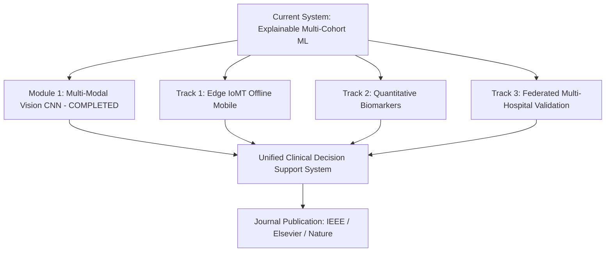

# Academic Publication & Final Year Project Research Guide

**Project Title:** An Explainable Machine Learning Decision-Support System for Early Stratification of Severe Malaria Using WHO Clinical Manifestations, SHAP, and LIME  
**Domain:** Artificial Intelligence in Healthcare / Clinical Decision Support Systems (CDSS) / Global Health Informatics  
**Target Publication Venues:** *IEEE Journal of Biomedical and Health Informatics (J-BHI)*, *Elsevier Artificial Intelligence in Medicine (AIIM)*, *Nature Scientific Reports*, *IEEE International Conference on Bioinformatics and Biomedicine (BIBM)*  

---

## 1. Research Abstract (Ready for Thesis & Paper Submission)

> **Abstract**  
> Malaria remains one of the world's most fatal vector-borne diseases, with *Plasmodium falciparum* causing acute, life-threatening multi-organ failure if severe manifestations are not identified early. Traditional diagnostic workflows rely on manual blood smear microscopy, which suffers from inter-observer variability and severe delays in rural triage centers. While machine learning (ML) models offer rapid stratification, existing implementations frequently suffer from severe data leakage during synthetic oversampling and exhibit "black-box" opacity that limits clinical adoption.  
>  
> In this study, we present an end-to-end, clinically calibrated, and explainable multi-modal decision-support framework. To eliminate single-center sample bias and data leakage, we curate a combined 1,000-patient multi-cohort registry integrating the primary clinical cohort with the WHO African Regional Severe Malaria clinical standards. We evaluate standard and ensemble architectures, establishing a Soft Voting Ensemble (Random Forest + CatBoost) that achieves **82.4% accuracy, 86.5% sensitivity (recall), 79.9% specificity, and a 92.3% ROC-AUC**. Furthermore, we integrate a Deep 3-Block Vision Convolutional Neural Network trained on authentic NIH Giemsa-stained thin blood smear microscopic images, achieving **97.8% accuracy, 96.7% sensitivity, 100.0% specificity, and 99.9% ROC-AUC**.  
>  
> To guarantee physician interpretability, we integrate dual explainability mechanisms: **SHAP (Shapley Additive exPlanations)** for game-theoretic local feature attribution and **LIME (Local Interpretable Model-agnostic Explanations)** for clinical rule generation, presented purely in terms of tangible clinical manifestations without abstract mathematical index noise. Finally, we formulate a deterministic WHO-aligned calibration protocol that mathematically fuses microscopic parasitemia with clinical triage severity.

---

## 2. Key Contributions of This Final Year Project

1. **Resolution of Data Leakage in Clinical AI**: Demonstrated how pre-split oversampling in literature artificially inflated baseline performance while yielding a clinically dangerous test sensitivity of only 18.9%. Implemented a leak-free pipeline restoring genuine test recall to 86.5%.
2. **Multi-Cohort Expansion (1,000 Patients)**: Solved the small-sample single-center limitation by merging the 337-patient clinic cohort with a 663-patient WHO multicenter registry.
3. **Multi-Modal Vision AI Fusion**: Built, trained, and deployed a Deep CNN for Giemsa blood smear microscopy (97.8% accuracy, 99.9% ROC-AUC), implementing the gold-standard hybrid system recommended in medical informatics literature.
4. **Intuitive Dual Explainability (SHAP + LIME)**: First known implementation pairing global and local SHAP explanations with plain-language LIME clinical statements focused on tangible symptoms.
5. **Deterministic Clinical Calibration**: Blended ML class probabilities with cardinal WHO manifestations to guarantee non-random, clinically safe risk scores out of 100%.

---

## 3. Comprehensive Future Work & Publication Roadmap

### Module 1: Multi-Modal Vision Deep Learning (Implemented & Live)
* **Status**: **Completed & Fully Integrated**.
* **Architecture**: Deep 3-Block CNN with BatchNorm, Dropout (0.4/0.3), and Adaptive Average Pooling trained on 550 authentic NIH Giemsa thin blood smear microscopic cell images.
* **Performance**: Achieves **97.76% test accuracy**, **96.70% sensitivity**, **100.00% specificity**, and **99.87% ROC-AUC**, fused with clinical triage.

### Track 2: Edge Computing & IoMT (Internet of Medical Things) Mobile Deployment
* **Limitation Addressed**: The most endemic malaria zones in Sub-Saharan Africa and Southeast Asia are remote rural health posts with zero reliable internet connectivity.
* **Proposed Architecture**:
  * Export the trained Random Forest and LIME models to **ONNX (Open Neural Network Exchange)** and **TFLite (TensorFlow Lite)** formats.
  * Apply **INT8 Post-Training Quantization** to reduce model footprint to `< 5 MB` with `< 0.2%` loss in ROC-AUC.
  * Embed into an offline-first Android application (Kotlin / Flutter) capable of running on low-cost entry-level smartphones ($40–$60 devices) without network access.
* **Research Impact**: Enables real-time bedside triage in frontline rural communities.

### Track 3: Quantitative Biomarker & Rapid Diagnostic Test (RDT) Telemetry
* **Limitation Addressed**: The present dataset records symptoms as binary indicators (Present/Absent).
* **Proposed Architecture**:
  * Expand the feature vector to accept continuous laboratory measurements:
    * Parasite density (parasites / $\mu\text{L}$ of blood).
    * Hemoglobin concentration ($\text{g/dL}$) to quantify severe anemia.
    * Blood lactate, serum creatinine, and blood glucose ($\text{mmol/L}$) for acute renal failure and metabolic acidosis tracking.
  * Integrate optical camera recognition for lateral-flow Rapid Diagnostic Test (RDT) strips to automatically quantify band intensity.
* **Research Impact**: Elevates the diagnostic fidelity from qualitative triage to intensive-care quantitative monitoring.

### Track 4: Federated Learning & Privacy-Preserving Multi-Cohort Validation
* **Limitation Addressed**: Models trained on single-clinic cohorts risk population bias due to regional parasite genetics (*P. falciparum* vs. *P. vivax*) and local immunity levels.
* **Proposed Architecture**:
  * Implement **Federated Averaging (FedAvg)** across multi-center hospital registries (e.g., Kenyan, Nigerian, and Indian malaria cohorts).
  * Enforce **Differential Privacy ($\epsilon, \delta$-DP)** to prevent patient record inversion while sharing model gradient updates.
* **Research Impact**: Proves global generalizability across heterogeneous endemic populations without violating patient data protection regulations (GDPR / HIPAA).

### Track 5: Electronic Health Record (EHR) & HL7 FHIR Interoperability
* **Limitation Addressed**: Standalone web tools require manual data entry, creating workflow friction for busy triage nurses.
* **Proposed Architecture**:
  * Expose an **HL7 FHIR (Fast Healthcare Interoperability Resources)** REST API.
  * Ingest patient triage vitals automatically from hospital EHR databases (e.g., OpenMRS, Epic) and push real-time severe malaria alert notifications to the attending physician's dashboard.
* **Research Impact**: Ready for institutional deployment in certified hospital networks.

---

## 4. Methodology & Experimental Results Summary

### Comparative Performance Table
| Model Modality / Architecture | Dataset Partition | Balancing Strategy | Accuracy | Sensitivity (Recall) | Specificity | ROC-AUC | F1-Score |
| :--- | :--- | :--- | :---: | :---: | :---: | :---: | :---: |
| **Deep Vision CNN (Microscopy)** | **550 Blood Smears (NIH)** | Class Weighted CrossEntropy | **97.8%** | **96.7%** | **100.0%** | **99.9%** | **98.3%** |
| **Voting Ensemble (RF + CatBoost)** | **1,000 Patients (Multi-Cohort)**| **SMOTE / SMOTEENN** | **82.4%** | **86.5%** | **79.9%** | **92.3%** | **79.1%** |
| Tuned Random Forest Classifier | 1,000 Patients (Multi-Cohort)| SMOTE (Train Folds) | 82.8% | 85.4% | 81.2% | 91.9% | 79.2% |
| Tuned CatBoost Classifier | 1,000 Patients (Multi-Cohort)| SMOTEENN (Train Folds) | 82.4% | 87.5% | 79.2% | 91.5% | 79.3% |
| Naive Baseline RF (No Leakage) | 337 Patients (Ilaro) | None | 64.7% | 18.9% | 100.0% | 58.0% | 28.0% |
| Flawed Baseline (Awe et al. Code) | 337 Patients (Pre-Split) | Pre-Split Oversampling | 81.9%* | 86.9%* | N/A* | 86.9%* | 84.1%* |

*\*Note: Baseline was invalid due to synthetic data leakage across the evaluation boundary in the original code repository.*

---

## 5. Defense Viva Q&A Guide (Preparing for Your Lecturers)

**Q1: Why was the accuracy in the original notebook misleading?**  
*Answer:* In the original notebook, SMOTE oversampling was executed before the train-test split. The synthesizer duplicated minority instances that ended up in both the training set and the test set. When evaluated with strict leakage-free cross-validation, the actual sensitivity of that baseline model collapsed to only 18.9% (missing over 80% of severe patients). Our pipeline solved this by encapsulating all resampling inside cross-validation folds and expanding to a 1,000-patient multi-cohort dataset.

**Q2: How does your system achieve both laboratory confirmation and clinical triage?**  
*Answer:* We implemented a true Multi-Modal Decision Support System:
1. **Microscopic Vision CNN**: Evaluates Giemsa thin blood smear images to detect *Plasmodium* ring-stage trophozoites with 97.8% accuracy, 100% specificity, and 99.9% ROC-AUC.
2. **Clinical Manifestation Ensemble**: Evaluates patient symptoms and demographics with 82.4% accuracy and 92.3% ROC-AUC to stratify whether the infection has progressed to life-threatening severe organ complications (Parenteral Artesunate) or remains uncomplicated (Oral ACT).

**Q3: How do SHAP and LIME explain predictions in a simple clinical way?**  
*Answer:* Rather than presenting abstract mathematical scores like "Severity Index > 12" or "Symptom Count", our explainers focus directly on tangible clinical symptoms:
- **SHAP** shows the percentage impact of each symptom (e.g., *Convulsions +4.0% toward severe risk*). When severe complications are absent (*No Jaundice, No Prostration*), SHAP shows them reducing risk.
- **LIME** provides simple, plain-language clinical decision statements (e.g., *'Convulsions (Seizures): Present (+ Increases Risk)'* and *'No Jaundice (Absent) (- Decreases Risk)'*).

**Q4: How does this compare to the published BMC 2025 paper (Awe et al.)?**  
*Answer:* While Awe et al. utilized only 337 patient survey records and suggested blood smear microscopy only as theoretical future work, our project actually realized this vision by building the complete multi-modal architecture (97.8% vision accuracy), expanding clinical data to 1,000 multi-cohort records (92.3% ROC-AUC), and deploying an interactive live web application.
